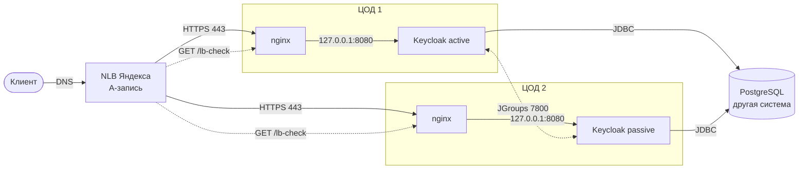
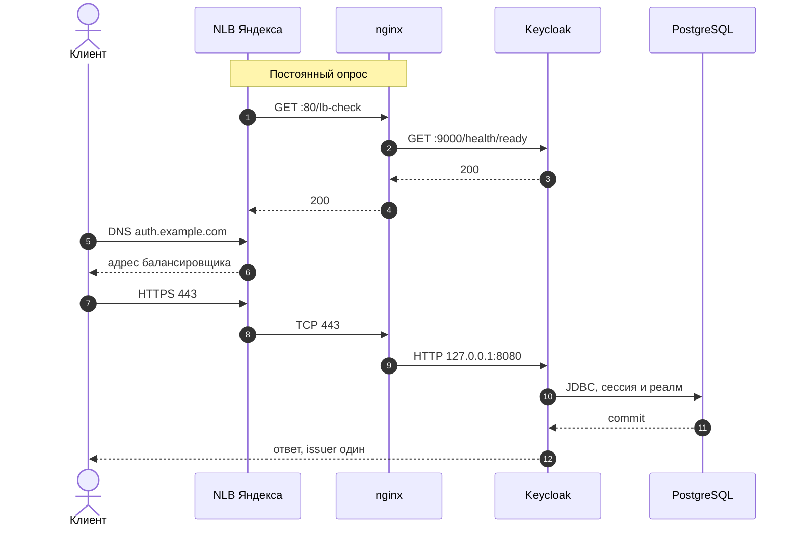

# Keycloak

Ansible-проект ставит и обновляет Keycloak 26.8 в Docker: два узла в одном кластере, перед каждым nginx. Образ собирается из `images/keycloak` вместе с темами и провайдерами. A-запись имени, например `auth.example.com`, указывает на Network Load Balancer Яндекса. Плейбук NLB и DNS не создаёт. NLB принимает TCP и отдаёт его на все здоровые узлы. Роли `active` и `passive` нужны для выпуска сертификата и порядка обновления.

PostgreSQL поднимает другая система. Плейбук только подключается к ней. Внешний Infinispan не используется. Сессии пользователей Keycloak 26 хранит в этой базе, поэтому запрос может прийти на любой живой узел и пользователь остаётся в сессии.

## Что должно быть у сети

- Задержка между двумя узлами Keycloak небольшая: они один JGroups-кластер. Та же сеть должна доставать PostgreSQL.
- NTP на узлах Keycloak.
- Ровно два узла Keycloak. В группе `keycloak` сначала `keycloak_role: active`, затем `passive` (только LE и порядок update; трафик на оба).
- Один hostname. A-запись смотрит на адрес NLB. Issuer OIDC должен быть одинаковым.
- Приватная сеть между двумя узлами Keycloak: по ней ходит JGroups.
- В целевой группе NLB оба узла. Проверка здоровья: HTTP, порт 80, путь `/lb-check`. Код 200 значит узел готов. Редирект NLB считает ошибкой. Проверки приходят из `198.18.235.0/24` и `198.18.248.0/24`.
- Слушатель NLB: TCP 443 на порт 443 узла. Для выпуска сертификата и редиректа с HTTP добавьте слушатель TCP 80 на порт 80.

## Схема

Один кластер Keycloak из двух узлов. Имя кластера одно (`keycloak`), узлы находят друг друга через JDBC_PING во внешней базе. nginx на узле завершает TLS и отдаёт запросы локальному Keycloak. Пока оба узла отвечают 200 на `/lb-check`, NLB шлёт трафик на оба.



Вход пользователя. Проверку здоровья делает NLB, не этот плейбук.



- JDBC URL берётся из `keycloak_db_hosts` или `keycloak_db_url`. Пишут оба узла Keycloak в одну базу.
- Если узел не проходит `/lb-check`, NLB перестаёт слать ему трафик. Второй узел продолжает принимать вход. Если недоступны оба, вход не работает, даже когда база ещё жива.

## Подготовка

ОС узлов: Ubuntu 24.04/26.04 LTS. Управляющая машина: ansible-core 2.16+. Keycloak — в Docker (JDK внутри образа).

Секреты (admin, БД, LDAP bind) — в ansible-vault: `inventories/prod/vault.yml.example` → `group_vars/all/vault.yml`.

```bash
cp inventories/prod/vault.yml.example inventories/prod/group_vars/all/vault.yml
# заполните vault_keycloak_admin_password, vault_keycloak_db_password,
# vault_keycloak_ldap_bind_password
ansible-vault encrypt inventories/prod/group_vars/all/vault.yml
```

Дальше поправьте `inventories/prod/hosts.yml` и `group_vars/all/main.yml` (`keycloak_hostname` и т.д.).

Без `keycloak_external` nginx получает self-signed на `keycloak_hostname`. Свои файлы — `keycloak_tls_cert_src` и `keycloak_tls_key_src`.

```yaml
keycloak_tls_cert_src: /path/on/controller/fullchain.pem
keycloak_tls_key_src: /path/on/controller/privkey.pem
```

Внешний Keycloak (`keycloak_external: true`) выпускает Let's Encrypt на активном узле. Проверка HTTP-01 приходит на порт 80 через NLB, поэтому nginx на обоих узлах отдаёт один и тот же файл проверки. Готовый сертификат активный узел ставит себе и копирует на пассивный по SSH (порт 22, пользователь из `ansible_user`), затем nginx на обоих перечитывает его. Продление каждый день в 03:15. На время первого выпуска пассивный узел ещё может быть не готов: NLB тогда видит только активный.

```yaml
keycloak_external: true
keycloak_acme_email: admin@example.com
```

## Плейбуки

Все команды из корня репозитория, обычно с `--ask-vault-pass`. Inventory по умолчанию — `inventories/prod` (см. `ansible.cfg`).

| Плейбук | Что делает |
| --- | --- |
| `playbooks/site.yml` | Полная установка с нуля: вызывает `platform.yml`, затем `realms.yml`. |
| `playbooks/platform.yml` | База хоста и платформа Keycloak **без** импорта реалмов. |
| `playbooks/configure.yml` | Повторная настройка уже установленных узлов (конфиг, TLS, firewall, fail2ban) **без** роли `common` и **без** реалмов. |
| `playbooks/realms.yml` | Импорт/обновление реалмов из `realms/*.yml` (один раз на кластер, `run_once`). |
| `playbooks/update.yml` | Обновление образа/конфига Keycloak по одному узлу (порядок inventory: сначала `active`). |
| `playbooks/status.yml` | Только диагностика: `docker compose ps`, `/health/ready`, `/lb-check`. Ничего не меняет. |

### `site.yml`

Импортирует по очереди:

1. `platform.yml`
2. `realms.yml`

Типичный первый запуск:

```bash
ansible-playbook playbooks/site.yml --ask-vault-pass
```

### `platform.yml`

1. **`common`** на всех хостах — пакеты, chrony.
2. **`keycloak`** на группе `keycloak`, `serial: 1` — Docker, Compose в `/opt/keycloak`, контейнер, nginx, TLS (LE / self-signed / свои файлы), systemd-unit `keycloak.service`.
3. **`firewall`** на всех — nftables (`inet keycloak_fw`), UFW гасится.
4. **`fail2ban`** на `keycloak` — jail по логу nginx.

Реалмы не трогает.

### `configure.yml`

То же, что платформенная часть без `common`:

1. **`keycloak`** (`serial: 1`) — перевыкладка conf/env/compose, pull образа при необходимости, restart при изменениях, ожидание ready, nginx, сертификат.
2. **`firewall`**
3. **`fail2ban`**

Для повседневных правок inventory/vault/TLS/firewall без полного site и без импорта реалмов:

```bash
ansible-playbook playbooks/configure.yml --ask-vault-pass
```

### `realms.yml`

Роль `keycloak_realm` один раз с active-узла (через API на `127.0.0.1:8080`):

- читает `realms/*.yml` (не `*.example`);
- создаёт отсутствующий реалм или обновляет настройки;
- `partialImport` клиентов/ролей/групп/IdP при наличии в файле;
- опционально LDAP, если заполнены `keycloak_ldap_*`;
- удаление: `-e '{"keycloak_realms_absent":["apps"]}'`.

```bash
ansible-playbook playbooks/realms.yml --ask-vault-pass
```

### `update.yml`

Только роль `keycloak`, `serial: 1`, порядок inventory. Нужен при смене тега образа (темы/провайдеры в образе) или когда достаточно прогнать роль Keycloak без firewall/fail2ban:

```bash
ansible-playbook playbooks/update.yml \
  -e keycloak_version=26.8.0 \
  -e keycloak_image=sysadm1989/keycloak:26.8.0 \
  --ask-vault-pass
```

### `status.yml`

На каждом узле Keycloak печатает роль, статус compose, HTTP-коды health и lb-check:

```bash
ansible-playbook playbooks/status.yml
```

### Образ Docker

На узлах крутится `sysadm1989/keycloak:{{ keycloak_version }}` (темы и провайдеры внутри). Серверы — `linux/amd64`:

```bash
cd images/keycloak
docker buildx build --platform linux/amd64 \
  -t sysadm1989/keycloak:26.8.0 \
  --build-arg KEYCLOAK_VERSION=26.8.0 \
  --push .
```

Unit `keycloak.service` вызывает `docker compose up/down` из `/opt/keycloak`.

### Truststores (LDAPS) и Kerberos (только office.corp)

На узле: `/opt/keycloak/truststores/` → в контейнере `/opt/keycloak/conf/truststores` (`truststore-paths`) — CA для LDAPS AD и FreeIPA.  
Kerberos/SPNEGO — только AD `OFFICE.CORP` (`office.corp`): keytab `/opt/keycloak/keytabs/`, `krb5.conf` → `/etc/krb5.conf`. FreeIPA без Kerberos.

```yaml
keycloak_truststores_src: "{{ playbook_dir }}/../files/keycloak/truststores"

keycloak_kerberos_enabled: true
keycloak_kerberos_keytab_src: "{{ playbook_dir }}/../files/keycloak/keytabs/keycloak.keytab"
keycloak_kerberos_krb5_src: "{{ playbook_dir }}/../files/keycloak/krb5.conf"
# или шаблон: keycloak_kerberos_default_realm + keycloak_kerberos_realms (OFFICE.CORP)
```

Пример `krb5.conf`: `files/keycloak/krb5.conf.example`. В Admin Console: Key tab = `/opt/keycloak/keytabs/keycloak.keytab`, realm `OFFICE.CORP`, principal `HTTP/sso.nemero.online@OFFICE.CORP`. Keytab в git не кладите.

Базу и пользователя создаёт другая система. Пользователь `keycloak_db_user` должен владеть базой `keycloak_db_name`, пароль — ключ `db_password` в HashiCorp Vault (`prod/keycloak`).

```yaml
keycloak_db_hosts:
  - keycloak.cluster.example
keycloak_db_tls_mode: verify-server
keycloak_db_ca_file: /path/on/controller/db-ca.pem
```

Несколько адресов означают выбор текущего primary (`targetServerType=primary`). Один адрес подключается напрямую. В Keycloak 26 для TLS к БД: `disabled` или `verify-server` (нужен `keycloak_db_ca_file`). Полный JDBC вместо списка — `keycloak_db_url`; вместе со списком его задавать нельзя.

## Реалмы

Файлы `realms/*.yml` — тот же документ, что у Admin API, только в YAML. Полный экспорт записывается списком `realms:`. Примеры: `realms/apps.yml.example`, `realms/gitlab.yml.example`, `realms/kubernetes.yml.example`. Плейбук сам переводит YAML в JSON запроса.

```bash
cp realms/gitlab.yml.example realms/gitlab.yml
cp realms/kubernetes.yml.example realms/kubernetes.yml
ansible-playbook playbooks/realms.yml --ask-vault-pass
```

GitLab и Kubernetes — отдельные реалмы с темой `nemero-ad` или `nemero-freeipa`. Учётные записи между ними не общие. Клиент GitLab — `gitlab`. Пользователи и группы GitLab читаются из LDAP, когда заполнены `keycloak_ldap_connection_url`, `keycloak_ldap_users_dn`, `keycloak_ldap_groups_dn`, `keycloak_ldap_bind_dn` и `keycloak_ldap_bind_password` (из ansible-vault: `vault_keycloak_ldap_bind_password`). Пока URL/DN пустые, каталог не подключается. Частично заполненный набор останавливает импорт. Для Active Directory: `keycloak_ldap_vendor: ad`. После заполнения — `playbooks/realms.yml`. Регистрация и смена пароля в Keycloak выключены. Имена групп в токене — из LDAP, claim `groups`. Клиент Kubernetes — конфиденциальный `kubernetes` для Dex. Перед импортом замените адреса и `secret`.

- Нет реалма — создаётся целиком.
- Реалм уже есть — обновляются его настройки, клиенты, роли, группы и identity providers (`ifResourceExists=OVERWRITE`).
- Пользователи из файла применяются только с `-e keycloak_realm_import_users=true`.
- Удаление: `-e '{"keycloak_realms_absent":["apps"]}'`.
- Секреты клиентов при OVERWRITE перезаписываются. Не храните боевые секреты в git.

Провайдеры — `images/keycloak/providers/*.jar`. Темы — `images/keycloak/themes/<name>/`. Они попадают в образ при `docker build` и в список Login theme реалма.

NEMERO — словознак с визитки (синий `#2E4298`, россыпь точек у O). Темы login:

- `nemero-ad` — светлая сторона визитки, Active Directory
- `nemero-freeipa` — синее поле, FreeIPA
- `nemero-master` — синее поле и бейдж MASTER REALM; задаётся в `realms/master.yml`

Превью: `open images/keycloak/themes/preview.html` (в браузере; встроенный preview IDE часто пустой) или `images/keycloak/themes/preview.jpg`. В реалме поле `loginTheme`. Смена темы — новый тег образа и `playbooks/update.yml`.

Реалм **ya360** — пример SAML IdP для Yandex 360 (`realms/ya360.yml.example`). Чтобы включить: `cp realms/ya360.yml.example realms/ya360.yml`. Админ и поля кабинета 360 — в `realms/ya360.md`.

## Порты

| Кто | Куда | Порт |
| --- | --- | --- |
| клиенты через NLB | nginx | 443 |
| NLB, `GET /lb-check` | nginx | 80 |
| Let's Encrypt, только при `keycloak_external: true` | nginx на обоих узлах | 80 |
| nginx | Keycloak | 127.0.0.1:8080 и :9000 |
| импорт реалмов на самом узле | Keycloak | 127.0.0.1:8080 |
| Keycloak active | Keycloak passive | 7800, 57800 |
| Keycloak | PostgreSQL | 5433 |

Порты 7800 и 57800 нужны только между двумя узлами Keycloak. Keycloak слушает 8080 и 9000 только на `127.0.0.1`. Снаружи их нет: на 9000 ещё и `/metrics`. Порт 80 с интернета открыт при `keycloak_external: true`. Сети проверки NLB открыты всегда.

## Внешний SSO

Снаружи открыт 443. Порт 80 с интернета открывается, когда `keycloak_external: true`: на нём проверка Let's Encrypt и редирект на HTTPS, кроме `/lb-check`. Остальное режет **nftables** (таблица `inet keycloak_fw`, без `flush ruleset` — с Docker не конфликтует). UFW отключается. Правила целиком из шаблона: `nft list table inet keycloak_fw`.

- `keycloak_external: true` + `keycloak_hostname` + `keycloak_acme_email` → Let's Encrypt на активном узле, копия на пассивном.
- Иначе без файлов сертификата → self-signed на `keycloak_hostname`.
- TLS завершает nginx. Клиентские `X-Forwarded-*` до Keycloak не доходят: nginx подставляет свои.
- Консоль администратора доступна на том же имени, что и вход пользователей. Плейбук её отдельно не закрывает.
- SSH по умолчанию открыт (`firewall_ssh_cidrs: [0.0.0.0/0]`), чтобы плейбук не закрыл себе вход. Сузьте список до сети администраторов. После смены CIDR снова `configure.yml`.

## Чего проект не делает

Не создаёт NLB Яндекса, A-запись и PostgreSQL. Не ставит мониторинг. Для TLS к базе задайте `keycloak_db_tls_mode` и `keycloak_db_ca_file`.

**fail2ban** смотрит `/var/log/nginx/keycloak-access.log`: 401/403 на `/realms/` и `/admin/`, плюс типичные сканы (`.env`, `wp-login.php` и т.п.). Бан через `nftables-multiport`, по умолчанию 10 срабатываний за 10 минут → бан на 1 час. NLB CIDR в `ignoreip`. Проверка: `fail2ban-client status nginx-keycloak`.
